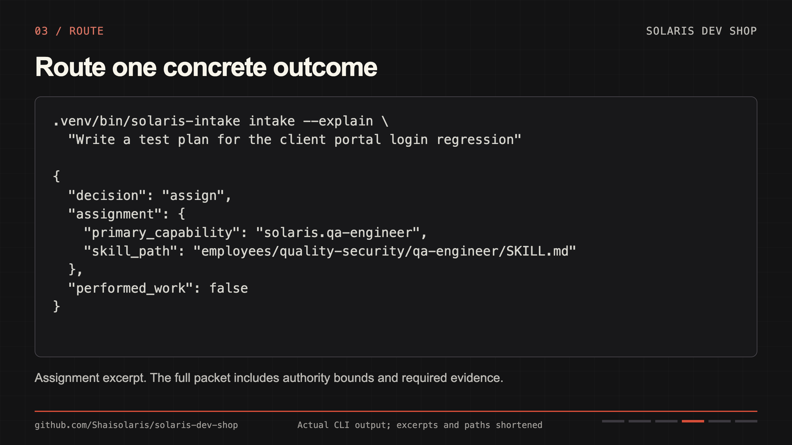
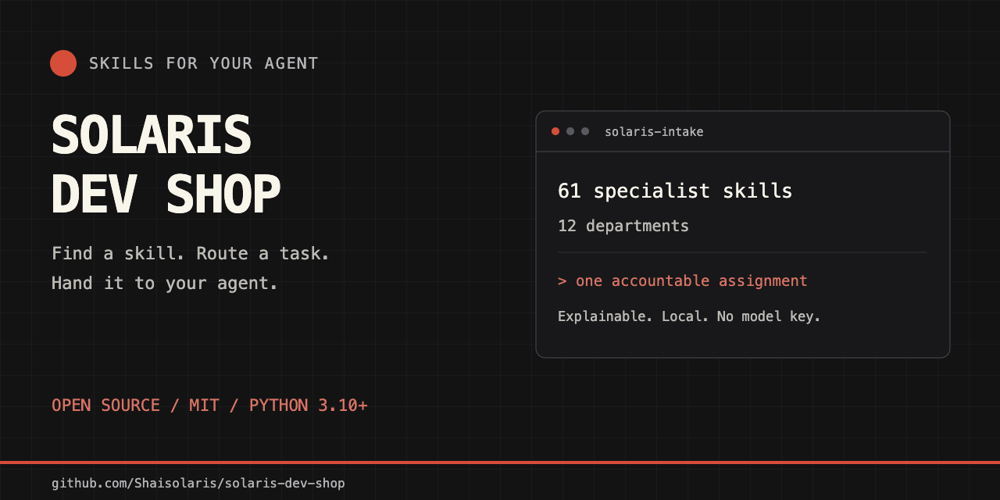

# Solaris Dev Shop


[](https://devshelf.ritualdev.in/tools/solaris-dev-shop.html)

**Find the right specialist skill, route a task, and carry its evidence requirements into your own agent.**

61 portable specialist skills across 12 departments, plus a chief-of-staff skill and an optional deterministic Python router. Free under MIT. No model calls, account or API key is needed to try the router.

The router produces an assignment packet. To do the work, you open the selected skill in your own coding agent with the tools and permissions that task needs. Solaris does not start agents, run a workforce, or grant access to your accounts.

## Try it

Requires Git and Python 3.10+. This first run leaves your PATH unchanged:

```bash
git clone https://github.com/Shaisolaris/solaris-dev-shop.git
cd solaris-dev-shop
python3 control-plane/meta_control_plane.py skills playwright
python3 control-plane/meta_control_plane.py intake --explain "Write a test plan for the client portal login regression"
```

On Windows, use `python` in place of `python3`.

The intake selects `solaris.qa-engineer` and returns:

```json
{
  "decision": "assign",
  "assignment": {
    "primary_capability": "solaris.qa-engineer",
    "skill_path": "employees/quality-security/qa-engineer/SKILL.md"
  },
  "performed_work": false
}
```

This is an excerpt; the full packet includes authority bounds, required evidence, confidence and runner-up. Confidence measures keyword evidence, not the probability that a result is correct. An unclear goal asks for clarification. Recognized high-risk wording triggers a human-review gate. Risk matching is lexical and does not grant permission for actions that are not flagged.

**Next:** open the returned `SKILL.md` in your agent, keep its companion files together, and supply the task and workspace. Follow [one complete handoff](docs/first-task.md), browse the [61 skills](docs/employees.md), or use the [Actions playground](docs/playground.md) without a local install.

[](https://github.com/Shaisolaris/solaris-dev-shop/releases/download/v0.56/solaris-dev-shop-0.56-walkthrough.mp4)

[Watch the 65-second narrated walkthrough](https://github.com/Shaisolaris/solaris-dev-shop/releases/download/v0.56/solaris-dev-shop-0.56-walkthrough.mp4) · [Transcript, captions and reproducible commands](docs/walkthrough.md)

## Choose a skill

After the optional `./install.sh` setup, the same commands are available as `solaris-intake`:

```bash
solaris-intake skills accessibility --department quality-security
solaris-intake skills "landing page" --json
solaris-intake intake --explain "review this code"
```

Search covers public names, summaries and tags. All query terms must match. Results include the source-tree path and GitHub link; searching does not install or execute a skill. The Python wheel contains the router and catalog, while the complete skill folders live in this repository.

## What is included

| Part | What it does |
|---|---|
| 61 specialist skills | Engineering, design, data, marketing, sales, leadership and more. Each has a `SKILL.md`, companion rules, manifest and capability contract. |
| Chief-of-staff skill | Helps your agent frame and route a bounded request. |
| Deterministic router | Produces one accountable assignment, supporting roles, authority bounds and required evidence. Runs on the Python standard library. |
| Skill discovery | Search by topic and department, then open the matching skill. Catalog drift is checked against the active roster in CI. |
| QA guidance | A documented [build, review and repair loop](docs/QA-LOOP.md). Actual review and execution depend on your host agent. |

Use a skill directly when you already know the specialist you need. Use intake when the task spans departments or you want a reviewable handoff. [Architecture and privacy](docs/architecture.md) explain the boundaries and opt-in local follow-up context.

## Install and portability

The source quickstart above is the smallest trial. `./install.sh` adds a managed `solaris-intake` command after checking the checkout. [Install instructions](docs/install.md) cover Windows, a local wheel, uninstall and copying skills into a host agent.

Provider-neutral means the skill text and routing packet do not require a particular model API. It does not mean every host supports the same tools or that outputs have equal quality across models. Review the selected skill's tools, references and scope before use.

## Quality and evidence

- [A reproducible first-task handoff](docs/first-task.md)
- [Routing benchmark and limits](docs/performance.md)
- [Multi-domain example](examples/multi-domain/README.md) and [safe escalation example](examples/escalation/README.md)
- [Known limits and FAQ](docs/faq.md)
- Structural audit: `python3 employees/quality-security/assurance/quality_os.py audit --html report.html`

CI checks routing, CLI behavior, safety gates, packaging and the 61-skill catalog on Linux, macOS and Windows. A separate YAML gate validates discovery metadata for all 61 specialists plus the coordinator. The structural audit checks documented output contracts and QA gates; it does not certify real-world skill outputs. The routing benchmark measures local Python routing, not model quality or autonomous task completion.

## Around the community

Solaris Dev Shop is listed on [DevShelf](https://devshelf.ritualdev.in/tools/solaris-dev-shop.html), [SilentStars](https://silentstars.dev/projects/shaisolaris--solaris-dev-shop/) and other community directories. See [verified public listings](docs/public-listings.md) for entries and their evidence. Directory inclusion does not imply an endorsement. [Project facts and media](docs/project-facts.md) provide reusable, evidence-backed descriptions.

[AI Agents Directory now has a live Solaris Dev Shop listing](https://aiagentsdirectory.com/agent/solaris-dev-shop), verified October 15, 2026. Its status is Standard / New. The publisher backlink below does not imply an editorial award:

[](https://aiagentsdirectory.com)

Postmake's free listing route requires its badge. This backlink is in place for that application; a Postmake listing has not yet been confirmed:

[](https://postmake.io)

## Contribute

- Found a routing miss? Open a [bug](.github/ISSUE_TEMPLATE/bug.md) with the command, expected specialist and observed result. Use synthetic examples without credentials or private data.
- Want a new specialist? Open a [new employee proposal](.github/ISSUE_TEMPLATE/new-employee.md).
- Improving the router? Run `python3 -m unittest discover -s tests -v` and `python3 control-plane/meta_control_plane.py self-test`.
- See the [roadmap](ROADMAP.md), [current issues](https://github.com/Shaisolaris/solaris-dev-shop/issues) or [show what you built](https://github.com/Shaisolaris/solaris-dev-shop/issues/18).

## Contributors

[](https://github.com/Shaisolaris/solaris-dev-shop/graphs/contributors)

[](https://star-history.com/#Shaisolaris/solaris-dev-shop&Date)

## License

MIT. See [LICENSE](LICENSE) and [NOTICE.md](NOTICE.md). Do not commit passwords, API keys, tokens or private account details.


