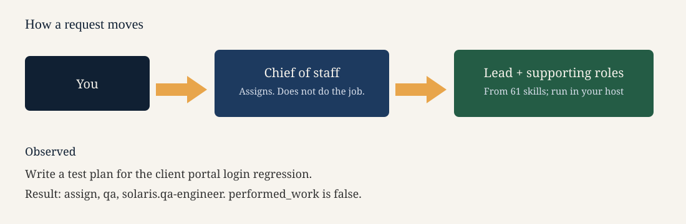

# Architecture



Three parts.

1. You send one request.
2. The chief of staff (`chief-of-staff/SKILL.md`) runs intake and emits one assignment. It does not do the specialist job.
3. One of the 61 employees does that job. You still confirm anything that spends money, deploys, or sends a message.

The intake command is:

```bash
python3 control-plane/meta_control_plane.py intake "Write a test plan for the client portal login regression"
```

On the run saved in `examples/route-a-task/`, that request was assigned to `solaris.qa-engineer`. The packet says `performed_work: false`.

The files in `control-plane/` are companions for routing, policy, budgets and skill discovery. They do not represent additional specialists.

Alfred stays out of this tree. A request the policy treats as personal health, personal finance, or travel escalates. It does not invent an Alfred employee here.

## Routing evidence

Use `solaris-intake intake --explain "review this code"`. The JSON includes the
detected domains, matched keywords, matching override rules, selection source and
runner-up. Every assignment carries `confidence` and `runner_up`, even without
`--explain`. Confidence is the winning keyword score divided by the winning and
runner-up scores. A tie is 0.5; an unscored fallback is 0. It is evidence strength,
not a calibrated probability that the specialist is correct. No model is called.

The policy includes explicit Spanish and French code-review phrases and a small
set of corresponding risk and personal-data signals. This is bounded phrase
support, not general translation. English remains the main routing vocabulary;
unsupported or underspecified requests may need clarification.

## Opt-in follow-up context

The default remains stateless. To keep a specialist for a referential follow-up:

```bash
solaris-intake intake --context ./routing-context.json "Design a logo for the sample coffee brand"
solaris-intake intake --context ./routing-context.json --explain "and make it red"
solaris-intake context clear ./routing-context.json
```

The local file stores only a format marker, version, specialist ID and domains.
It stores no request, response, credential, provider session or permission. It
is atomically replaced after an assignment, has owner-only permissions on POSIX,
and remains local until you delete it with `context clear`. Add its path to your
own ignore list if you keep it in a repository. Do not use shared folders for it.

Context is considered only for a narrow referential follow-up with no new keyword
route. A clearly stated new task routes normally. Authority and high-risk checks
always run on the new request first; stored context cannot grant permission or
override a safety gate. Clearing refuses unrelated JSON and symlink paths.

## WordPress diagnostic sub-skills

The 38 folders under `employees/specialized/wordpress-master/diagnostics/` are
internal diagnostic procedures owned by `solaris.wordpress-master`. They are
intentionally absent from the top-level roster: otherwise a WordPress request
could select a narrow check before the parent has established scope and access.
The parent selects the relevant procedure, coordinates its evidence and remains
the single accountable specialist. These procedures are not 38 extra employees.

## Reproducible evidence

- [Multi-domain walkthrough](../examples/multi-domain/README.md)
- [Escalation walkthrough](../examples/escalation/README.md)
- [Latency benchmark and limits](performance.md)
- [Try the router without a local install](playground.md)

The self-test checks the actual `fixtures/control-plane/` directory in a checkout.
The test suite also verifies those fixture expectations and all 61 specialist
routes. A packaged wheel runs the built-in smoke checks; checkout fixtures and
employee skill directories remain source-distribution material.

## Discoverable handoff

`solaris-intake skills` searches a bundled catalog derived from the 61 existing
skill contracts and manifest tags. `--department` filters an exact department;
`--json` emits structured public metadata. All search terms must match. CI checks
the catalog against the source and active roster. Assignment packets include
`skill_path` and `skill_source_url` (additive schema 1.2 fields). Paths refer to
the source checkout, and links refer to the current default branch. The wheel
does not contain or execute employee folders. Record a checkout commit when a
handoff needs an immutable source. See [the first-task walkthrough](first-task.md).

## Risk matching and production actions

Risk checks run before ambiguity or saved-context routing. Alongside explicit
phrases, the policy pairs a production target (`production`, `prod`, `live`)
with an action such as deploy, deployment, release or publish, even when an
application name separates them. Matching uses whole words, so `product` does
not match `prod`. Staging alone does not trigger this combination.

This is conservative lexical matching. A plan or negated sentence that includes
both signals can still request human review. Unrecognized wording can be missed;
a low-risk label is not authorization or a substitute for the host agent's
permission checks. The router never executes an action.
